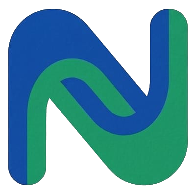
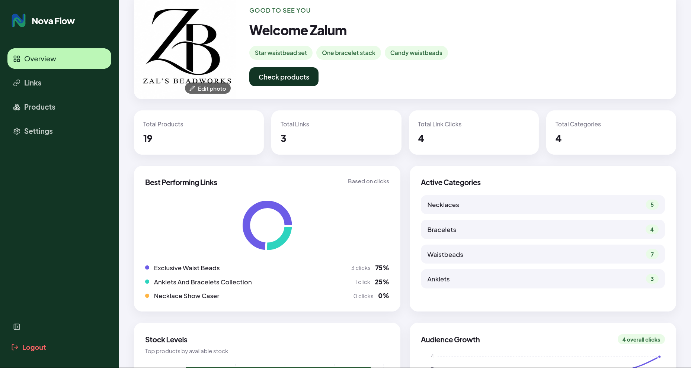
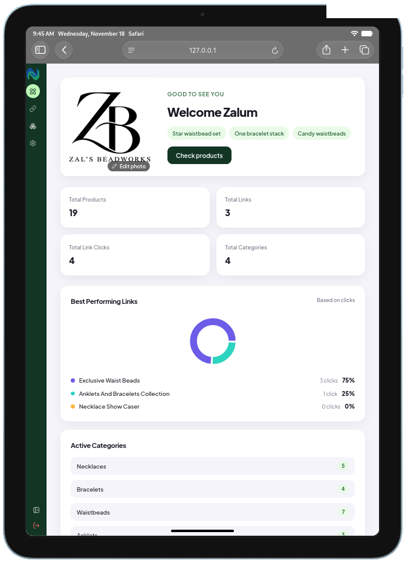
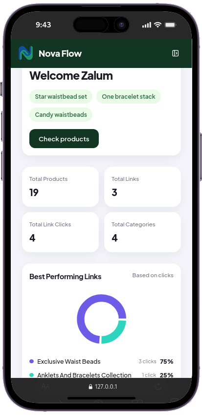

<p align="center">
  
</p>

# NovaFlow

NovaFlow is a web platform designed for independent sellers, artisans, and creators to catalog products, bundle categories into custom shareable storefront links, and monitor traffic analytics from a private dashboard.

[](https://laravel.com)
[](https://react.dev)
[](https://inertiajs.com)
[](https://tailwindcss.com)
[](https://www.typescriptlang.org)
[](https://www.postgresql.org)

---

## What NovaFlow Does

NovaFlow combines an inventory management system, a link compilation engine, and a public product gallery under one platform:

1. **Inventory Management**: Sellers add products with photos, descriptions, pricing, optional discounts, and stock quantities, and organize them into custom categories.
2. **Category Link Compilation**: Instead of sending a buyer a single massive catalog or sending loose photos through chat apps, sellers select specific categories and compile them into a dedicated link with a custom slug (e.g. `/summer-collection` or `/ceramics`).
3. **Public Product Gallery**: Anyone with the link can view the curated product showcase without creating an account. Visitors can filter by category, search by keyword, view full product details in a modal, and share product cards directly via WhatsApp or the native Web Share API.
4. **Performance Tracking**: Sellers track how many clicks their links receive, monitor inventory levels (in stock, low stock, out of stock), and review audience engagement trends over time.

---

## Application Screenshots

### Desktop Dashboard & Storefront Preview
<p align="center">
  
</p>

### Tablet & Mobile Views
<table width="100%">
  <tr>
    <th width="50%" align="center">Tablet View</th>
    <th width="50%" align="center">Mobile Storefront</th>
  </tr>
  <tr>
    <td align="center" valign="top">
      
    </td>
    <td align="center" valign="top">
      
    </td>
  </tr>
</table>

---

## Features

### Product & Category Management
- Full CRUD operations for products and categories.
- Many-to-many relationship: products can belong to multiple categories.
- Fields include product name, slug, description, image upload, price, optional discount price, and stock count.
- Automatic slug generation for clean URL routing.

### Curated Link Generator
- Sellers create unique storefront links by selecting one or more categories.
- Custom slug assignment (e.g. `/{slug}` or `/links/{slug}`).
- Built-in click counter increments on every visit.

### Public Storefront
- No authentication required for visitors.
- Real-time search across product titles and descriptions.
- Category filtering tabs for quick browsing.
- Product inspection modal with high-resolution image, pricing, stock badge, and description.
- Direct product sharing with pre-formatted WhatsApp text and Web Share API support.
- Deep links for individual products (`/links/{slug}/{product}`).

### Analytics Dashboard
- Total click tracking across generated links.
- Audience engagement and visit trends visualized with Recharts.
- Stock level breakdown:
  - **In Stock**: Available inventory.
  - **Low Stock**: Nudge warning when stock drops below threshold.
  - **Out of Stock**: Flagged to prevent overselling.
- Quick product and link overview tables.

### Authentication & User Settings
- Powered by Laravel Fortify.
- Passkey support (WebAuthn / biometric sign-in via `@laravel/passkeys`).
- Two-Factor Authentication (2FA) with TOTP QR codes and recovery codes.
- Theme preference (Light and Dark mode) saved per user.

---

## Tech Stack

| Layer | Technology |
| :--- | :--- |
| **Backend** | [Laravel 13](https://laravel.com) (PHP 8.4) |
| **Frontend** | [React 19](https://react.dev) with [TypeScript](https://www.typescriptlang.org) |
| **SPA Bridge** | [Inertia.js v3](https://inertiajs.com) (`@inertiajs/react` & `@inertiajs/vite`) |
| **Styling** | [Tailwind CSS v4](https://tailwindcss.com) with `@tailwindcss/vite` |
| **UI Components** | [Radix UI](https://www.radix-ui.com) & [Lucide React](https://lucide.dev) |
| **Charts** | [Recharts](https://recharts.org) |
| **Authentication** | [Laravel Fortify](https://laravel.com/docs/fortify) with Passkeys & 2FA |
| **Routing** | [Laravel Wayfinder](https://github.com/laravel/wayfinder) (type-safe TypeScript routes) |
| **Database** | [PostgreSQL](https://www.postgresql.org) |
| **Testing** | [Pest PHP](https://pestphp.com) |

---

## Database Architecture

NovaFlow stores user accounts, products, categories, and generated links with the following structure:

- **`users`**: User profile, authentication credentials, avatar, two-factor secrets, and theme preference (`light` / `dark`).
- **`categories`**: Category name and slug.
- **`products`**: Product details (name, slug, description, image path, price, discount, stock quantity) scoped to `user_id`.
- **`category_products`**: Pivot table associating products with one or more categories.
- **`links`**: Shareable links containing a unique `slug`, creator `user_id`, and `clicks` counter.
- **`category_link`**: Pivot table binding categories to a specific shareable link.

---

## Getting Started

### Prerequisites
- **PHP**: `^8.3` or `^8.4` with standard extensions (`pdo`, `mbstring`, `openssl`, `tokenizer`, `xml`, `ctype`, `json`, `curl`)
- **Composer**: `^2.x`
- **Node.js**: `^20.x` or `^22.x` and `npm`
- **Database**: PostgreSQL (or SQLite for local development)

### 1. Clone the Repository
```bash
git clone https://github.com/your-username/nova-flow.git
cd nova-flow
```

### 2. Install Dependencies
```bash
# Install PHP dependencies
composer install

# Install JavaScript dependencies
npm install
```

### 3. Configure Environment
```bash
cp .env.example .env
php artisan key:generate
```

Update your `.env` file with your database credentials:
```dotenv
DB_CONNECTION=pgsql
DB_HOST=127.0.0.1
DB_PORT=5432
DB_DATABASE=novaflow
DB_USERNAME=your_database_user
DB_PASSWORD=your_database_password
```

### 4. Run Migrations & Setup Storage
```bash
# Run database migrations
php artisan migrate

# Link public storage directory for product images
php artisan storage:link
```

### 5. Start Development Servers
In your terminal, run Vite:
```bash
npm run dev
```

In a separate terminal, start the Laravel server:
```bash
php artisan serve
```

Open your browser and navigate to `http://localhost:8000`.

---

## Testing & Code Quality

```bash
# Run Pest test suite
php artisan test --compact

# Format PHP code with Pint
vendor/bin/pint --format agent

# Type-check TypeScript
npm run types:check

# Run ESLint
npm run lint

# Format frontend code with Prettier
npm run format
```

---

## Project Structure

```text
nova-flow/
├── app/
│   ├── Actions/Fortify/           # Fortify authentication actions (2FA, Passkeys, Profiles)
│   ├── Http/Controllers/          # Controllers (Dashboard, Links, Products, Categories)
│   └── Models/                    # Eloquent models (User, Product, Category, Link)
├── database/
│   ├── migrations/                # Database schema migrations
│   └── seeders/                   # Development database seeders
├── public/
│   └── images/
│       ├── novaflow-symbol.png    # Application logo
│       └── novaflow-homepage/     # Desktop, tablet, and mobile UI previews
├── resources/
│   ├── css/                       # Tailwind CSS stylesheets
│   └── js/
│       ├── components/            # UI components and layout elements
│       ├── pages/                 # Inertia React pages (Dashboard, Products, Links, Welcome)
│       └── routes/                # Wayfinder generated TypeScript routes
├── routes/
│   ├── web.php                    # Public and authenticated web routes
│   └── settings.php               # User settings and security routes
├── tests/                         # Pest PHP feature and unit tests
├── NOVA_PRD.md                    # Product requirements document
└── vite.config.ts                 # Vite bundler configuration
```

---

## License

This project is licensed under the MIT License.
